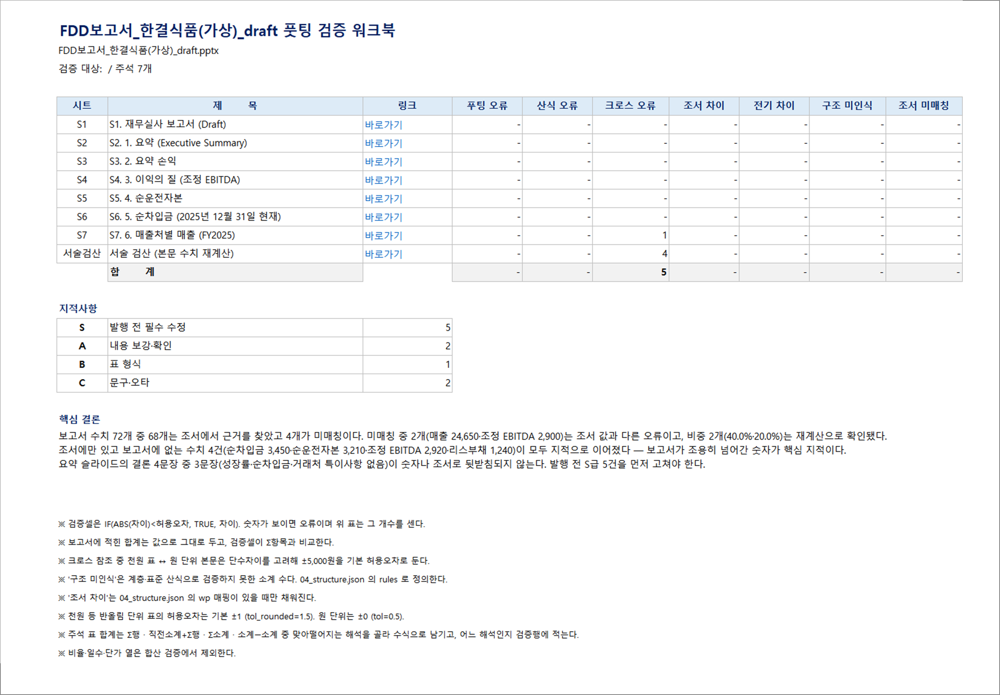
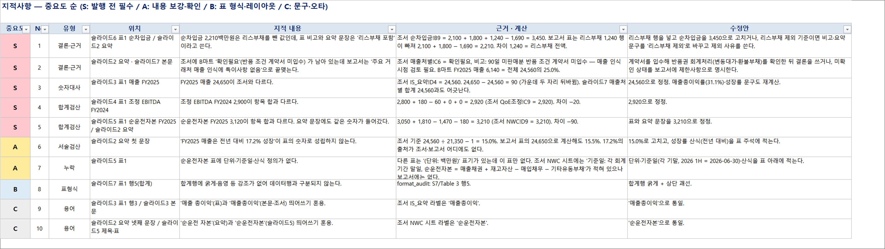
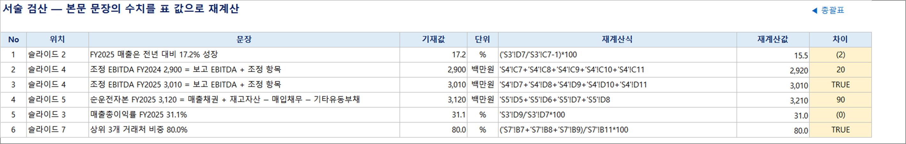
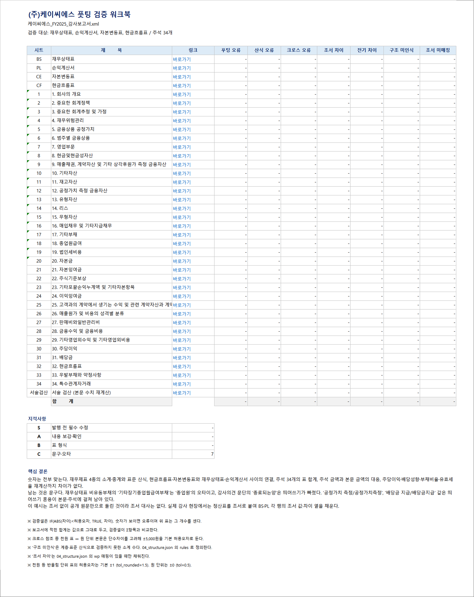
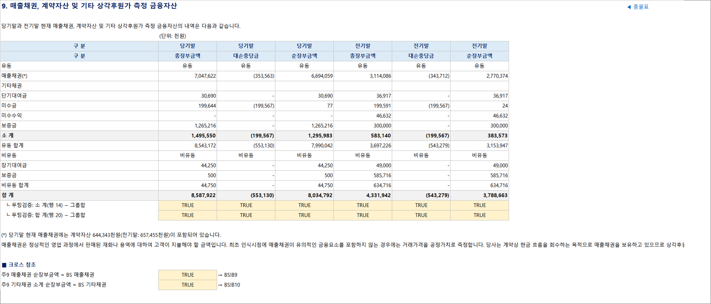

# footing — 보고서 풋팅(tie-out) 스킬

회계·재무 보고서 draft를 근거 조서와 **전수 대사**하고, 지적사항을 중요도 순으로 정리한 엑셀 한 장을 만드는
[Claude Code](https://claude.com/claude-code) 스킬이다. 숫자(합계·조서·표간 대사)만이 아니라
**결론이 근거로 뒷받침되는가**, 보고서가 조용히 넘어간 숫자는 없는가, 오타·띄어쓰기·표 형식까지 본다.

```
보고서 draft (dsd · DART 원문 XML · pptx · docx · htm · pdf)  +  조서 (xlsx)
        │
        │  extract → tie_out · format_audit · build_workbook  (스크립트: 사실만 뽑는다)
        │  판단 — 지적 확정 · 중요도 · 구조 정의                (모델의 일)
        ▼
풋팅결과_{보고서명}.xlsx
   ├ 총괄표 · 지적사항(S/A/B/C) · 숫자대사 · 검증완료
   └ 검증 워크북 — 보고서를 옮겨 적고 검증식을 살아 있는 수식으로 심은 재수행 조서
```

검증셀은 `=IF(ABS(차이)<허용오차, TRUE, 차이)`. 숫자가 보이면 오류다. 보고서에 적힌 합계는 값으로 두고
검증셀이 Σ항목과 비교하므로, `=SUM` 을 넣어 항상 참이 되는 일이 없다.

## 예시 1 — 재무실사(FDD) 보고서 (가상 회사, 오류를 일부러 심음)

`examples/fdd-report/` — ㈜한결식품(가상)의 재무실사 보고서 draft(pptx)와 실사조서(xlsx).
회사·숫자는 전부 지어낸 것이고, 보고서에 오류 8개를 심어 두었다 (`make_sample.py` 의 `PLANTED`).

| 심은 오류 | 잡힌 곳 |
|---|---|
| 매출 FY2025 24,650 (조서 24,560) | 숫자대사 미매칭 · 슬라이드7 합계 ↔ 슬라이드3 크로스 −90 |
| 조정 EBITDA FY2024 합계 2,900 (항목 합 2,920) | 서술검산 +20 · 조서에만 있는 수치 2,920 |
| "전년 대비 17.2% 성장" (실제 15.0%) | 서술검산 −2 |
| 순차입금 표에서 리스부채 1,240 누락, 본문은 "리스부채 포함" | 조서에만 있는 수치 3,450 · 1,240 → S급 결론·근거 |
| 조서에 B마트 '확인필요' 잔존, 보고서는 "특이사항 없음" | 조서 미결 플래그 → S급 결론·근거 |
| 순운전자본 FY2025 합계 3,120 (항목 합 3,210) | 서술검산 +90 · 조서에만 있는 수치 3,210 |
| 순운전자본 표 단위·기준일·산식 누락 | A급 누락 |
| 매출 총이익/매출총이익, 순운전 자본/순운전자본 혼용 | C급 용어 |





## 예시 2 — 상장사 감사보고서 (DART 공개 원문, 조서 없음)

`examples/audit-report/` — (주)케이씨에스 제24기(FY2025) 감사보고서. DART 에 공시된 원문 XML
(rcept_no 20260318001267, 사업보고서 첨부 `_00760.xml`) 을 그대로 넣었다. 공개 자료라 실명 그대로다.

재무제표 4종 계층·표준 산식 362건, 재무제표 간 크로스 3건, 주석 34개의 표 합계 235건,
주석 ↔ 본문 크로스 27건, 주당이익·배당성향·부채비율·유효세율 재계산 5건 — **차이 0**.
남은 지적은 문구 7건 (재무상태표 '기타장기종업웝급여부채' 오타, 감사의견 문단 띄어쓰기, 용어 혼용).
조서가 없으므로 조서 대사 열은 비어 있다. 실제 감사에서는 정산표를 조서로 붙인다.





## 설치

```
git clone https://github.com/joongpark0902/footing-skill.git ~/.claude/skills/footing
pip install openpyxl python-pptx python-docx pymupdf
```

Python 3.10+. `pymupdf` 는 pdf 입력일 때만 필요하다. Windows 에서 산출물을 엑셀로 열어 재계산 검증하는 단계는 `pywin32` 를 쓴다(선택).

## 사용

Claude Code 에서:

```
풋팅해줘 C:\작업\보고서폴더
풋팅 "draft.pptx" "조서.xlsx" 유형: 재무실사
```

폴더만 주면 보고서(.dsd/.xml/.pptx/.htm/.docx/.pdf)와 조서(.xlsx/.xlsm)를 찾아 시작한다.
절차는 `SKILL.md` 에 있다 — Phase 0 입력 확정 → 1 추출 → 2 기계 감사 → 3 판단 → 4 산출 → 5 응답.

스크립트만 쓰려면:

```
python scripts/extract.py 보고서.pptx -o _footing/run/01_report.json
python scripts/extract.py 조서.xlsx   -o _footing/run/01_wp.json
python scripts/tie_out.py      _footing/run/01_report.json _footing/run/01_wp.json -o _footing/run/02_tieout.json
python scripts/format_audit.py _footing/run/01_report.json -o _footing/run/02_format.json
python scripts/build_workbook.py _footing/run/01_report.json -o 풋팅결과.xlsx \
       --findings _footing/run/03_findings.json --structure _footing/run/04_structure.json
```

`03_findings.json`(지적사항)과 `04_structure.json`(소계 산식·조서 매핑·크로스·서술검산)은 모델이 쓴다.
두 예시 폴더의 `_footing/*/03_findings.json`, `04_structure.json` 이 실제 작성 예다.

## 구성

| 경로 | 내용 |
|---|---|
| `SKILL.md` | 절차와 철칙 (보고서 원본을 고치지 않는다 · 근거 없는 지적을 쓰지 않는다 · 기계가 판단하지 않는다) |
| `scripts/extract.py` | 보고서·조서 → 정규화 블록 JSON. dsd/XML 은 `dsd.py` 가 재무제표·주석 구조까지 낸다 |
| `scripts/tie_out.py` | 수치 전수 대사 — 조서 exact · 연속구간 합 · 보고서 내부 합 · 파생(비율·차액), 표 합계 검산, 조서에만 있는 수치 |
| `scripts/format_audit.py` | 표 형식·띄어쓰기·placeholder·합계행 강조 등 기계 점검 |
| `scripts/build_workbook.py` | 검증 워크북 생성 — 재무제표 계층·표준 산식·크로스·주석 표 합계(5가지 해석)·변동표 행검증·조서 대사·전기 대사·서술검산 |
| `scripts/build_report.py` | 지적사항 시트 (워크북 없이 쓸 때) |
| `references/` | 점검 항목 · 중요도 기준 · 워크북 서식과 `04_structure.json` 스키마 · 유형별 프로파일(검토감사·투자금실사·재무실사) |

## 입력 형식 메모

- **dsd** (DART 편집기 파일) 가 가장 좋다. `ALEVEL` 계층·계정코드가 살아 있다.
- **DART 공개 원문 XML** 도 같은 파서로 읽는다. 계층 속성이 빠져 있어 로마숫자·번호·들여쓰기로 추정하고,
  주석 제목과 첫 문장이 붙어 있는 것을 갈라낸다. 본문의 `<당기말>` 같은 꺾쇠 표기는 `xml_fix.py` 가 보정한다.
- **pptx** 는 슬라이드별 표·문단, **xlsx** 조서는 셀 단위(시트·행·열 좌표 포함).

## 고객 자료는 올리지 않는다

이 저장소에는 코드·문서와 **공개 자료(DART 공시)·가상 자료** 로 만든 예시만 들어 있다.
작업 폴더(`_footing/`)의 추출 JSON·중간 워크북과 루트의 xlsx/pptx/dsd/pdf 는 `.gitignore` 로 막아 두었다.
실제 고객 보고서·조서로 돌린 결과는 커밋하지 말 것.

---

### English

**footing** is a Claude Code skill that ties out a draft report (audit/review report, financial due diligence
deck, valuation report) against its supporting workpapers and produces one Excel file: a severity-ranked list of
findings plus a *live* verification workbook — the report re-keyed with check formulas
(`=IF(ABS(diff)<tol, TRUE, diff)`), footings, standard identities, cross-statement and note-to-face cross references,
workpaper ties and narrative re-computations. Scripts extract facts; the model makes the calls (what is a finding,
how severe, which subtotal rule applies). Inputs: DART `.dsd` or published DART XML, pptx, docx, htm, pdf; workpapers as xlsx.
Two worked examples are included: a fictional FDD deck with planted errors, and a listed company's audit report from public DART filings.
MIT license.
